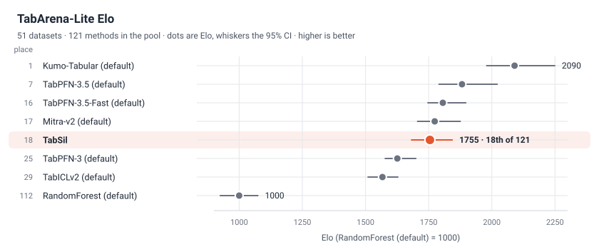
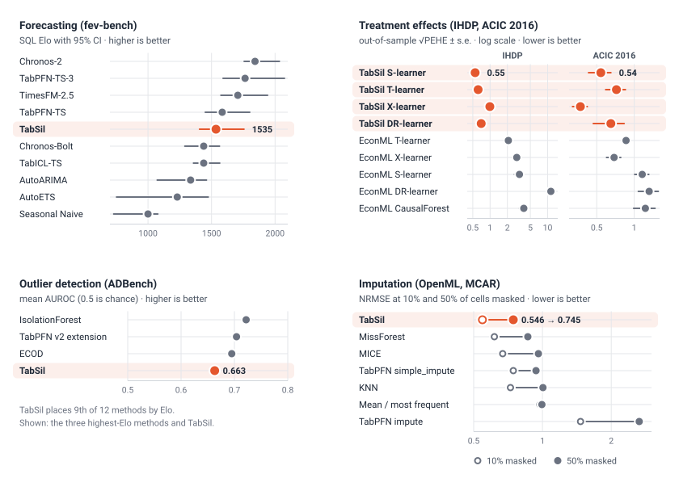

<p align="center">
  <picture>
    <source media="(prefers-color-scheme: dark)" srcset="assets/logo/tabsil-logo-dark.svg">
    
  </picture>
</p>

# TabSil

TabSil is a tabular foundation model. One model handles both classification and regression: give it a training table and it predicts test rows in a single forward pass (in-context learning), with no gradient steps on your data. It is trained only on synthetic tables drawn from a structural causal model prior.

*Sil* (실) is Korean for *thread*: the model reads a table by weaving through its columns and rows.

This repository has everything needed to reproduce TabSil. It holds two packages:

- `tabsil` (`src/tabsil/`): inference only. The model, the scikit-learn style estimators, and loading weights from the Hugging Face Hub.
- `tabsil-train` (`training/`, imported as `tabsil_train`): the synthetic-data prior, the training curriculum, the benchmark harness, and the Hub upload scripts.

The v1 weights and the model card are on the Hugging Face Hub: [aiden-jeon/tabsil](https://huggingface.co/aiden-jeon/tabsil).

## Install

```bash
uv add tabsil                     # or: pip install tabsil
uv add "tabsil @ git+https://github.com/Aiden-Jeon/tabsil"   # the latest main instead of a release
```

Python ≥ 3.11, PyTorch ≥ 2.11.

## Use

Without a model, the estimators download the v1 weights from the Hub at the tag `v1.1` (`tabsil.recipe.HUB_REVISION`), so a release keeps the same weights when the repo's `main` changes. Other weights are given as the first argument: a Hub repo id (`"aiden-jeon/tabsil@stage2-10k"` for a branch, tag or commit), a folder written by `tabsil.hub.save_pretrained`, or a model from `tabsil.models.load_checkpoint`.

### Classification and regression

```python
from tabsil import TabSilClassifier, TabSilRegressor

clf = TabSilClassifier(device="cuda").fit(X_train, y_train)
proba = clf.predict_proba(X_test)

reg = TabSilRegressor(device="cuda").fit(X_train, y_train)
y_pred = reg.predict(X_test)
```

Both average an ensemble of 8 preprocessing members (column subsets, four numeric transforms, count columns for high-cardinality categories). `fit` runs the training rows through the model once, so `predict` runs only the test rows.

### Forecasting

(tabsil ≥ 0.1.2) Zero-shot, as TabPFN-TS: each time step is a row of time features (index, calendar, FFT-detected seasonality; no lags), and the quantiles come from the regressor. Each series is fit on its last 4,096 rows (`max_context_length`).

```python
from tabsil import TabSilForecaster

# context: one row per (item_id, timestamp) with a target column; other columns are covariates
fc = TabSilForecaster(device="cuda").fit(context)
pred = fc.predict(24)  # item_id, timestamp, predictions, "0.1" ... "0.9"
pred = fc.predict(future=future, quantile_levels=[0.05, 0.5, 0.95])  # known covariates in `future`
```

### Outlier detection

(tabsil ≥ 0.1.2) Without labels: a log density per row from column conditionals chained along 10 random column orders, as the official TabPFN extension does.

```python
from tabsil import TabSilUnsupervised

model = TabSilUnsupervised(device="cuda").fit(X_train)  # unlabeled rows: the context
scores = model.outlier_score(X_test)  # = -model.log_density(X_test); higher = more anomalous
```

### Imputation

(tabsil ≥ 0.1.2) From the same conditionals, one fit per column with a missing value: the predictive mean for numeric cells (`strategy="median"` for the median), the most probable class for categorical ones. Without `categorical_features`, columns with at most 40 distinct values and more than 10 rows per value are treated as categorical.

```python
model = TabSilUnsupervised(categorical_features=[3, 5], device="cuda").fit(X)  # X with NaN
X_filled = model.impute(X)  # observed cells unchanged
draws = model.impute(X, n_samples=5)  # multiple imputation: (5, n, d)
```

### Treatment effects

(tabsil ≥ 0.1.2) A meta-learner (`learner="s" | "t" | "x" | "dr"`) with TabSil as the base learner, for a binary treatment and a continuous outcome. `regressor=` and `classifier=` take any scikit-learn estimator instead of TabSil.

```python
from tabsil import TabSilCATE

est = TabSilCATE(device="cuda").fit(X, treatment, y)  # the S-learner
tau = est.effect(X_test)  # CATE per row
ate = est.ate()  # mean CATE over the training rows
```

The module docstrings of `src/tabsil/tasks/forecast.py`, `unsupervised.py` and `causal.py` give the defaults, the missing value handling and the differences from TabPFN-TS, the TabPFN extension and EconML.

## Benchmarks

### TabArena-Lite

With TabArena's official pipeline (51 datasets, 8-fold bagging, [autogluon/tabarena#753](https://github.com/autogluon/tabarena/pull/753)), TabSil places 18th of 121 methods. Elo puts RandomForest (default) at 1000. Shown: a hand-picked subset (4 of the 17 methods above TabSil, TabPFN-3 and TabICLv2, RandomForest); the [full table](https://huggingface.co/datasets/aiden-jeon/tabsil-tabarena-lite/blob/1c4beda3ed9683fa5bd15f4cc9569a8180b04ec4/leaderboard_website.md) has all 121. Measured with tabsil 0.1.0.

<p align="center">
  <picture>
    <source media="(prefers-color-scheme: dark)" srcset="assets/charts/tabarena-lite-dark.svg">
    
  </picture>
</p>

<details>
<summary>Table: Elo, improvability, fit and infer time</summary>

| Method | Place | Elo (+CI) | Improvability (%) | Fit (s/1K) | Infer (s/1K) |
| --- | --- | --- | --- | --- | --- |
| Kumo-Tabular (default) | 1 | 2090 (+159/−110) | 3.7 | 2.33 | 0.254 |
| TabPFN-3.5 (default) | 7 | 1882 (+139/−91) | 7.5 | 1.85 | 0.473 |
| TabPFN-3.5-Fast (default) | 16 | 1806 (+91/−59) | 9.1 | 0.73 | 0.153 |
| Mitra-v2 (default) | 17 | 1774 (+101/−68) | 8.5 | 59.03 | 0.886 |
| **TabSil** | **18** | **1755** (+88/−73) | 9.0 | 2.53 | 0.812 |
| TabPFN-3 (default) | 25 | 1626 (+73/−48) | 11.6 | 1.29 | 0.383 |
| TabICLv2 (default) | 29 | 1567 (+61/−57) | 13.1 | 0.73 | 0.137 |
| RandomForest (default) | 112 | 1000 (+74/−75) | 28.4 | 0.43 | 0.053 |

</details>

### Other tasks

Zero-shot with the same weights, at the Hub tag `v1.1`. The tables, protocols and comparison methods are in [docs/task-results.md](docs/task-results.md).

<p align="center">
  <picture>
    <source media="(prefers-color-scheme: dark)" srcset="assets/charts/other-tasks-dark.svg">
    
  </picture>
</p>

More results (AMLB, per-problem-type and per-stage Elo) are on the [model card](https://huggingface.co/aiden-jeon/tabsil).

## Training and evaluation

From a clone:

```bash
git clone https://github.com/Aiden-Jeon/tabsil
cd tabsil
uv sync --all-packages            # tabsil + tabsil-train + dev tools
```

TabSil is trained on synthetic tables from the TabICLv2 graph SCM prior, in the TabICLv2 three-stage curriculum. `training/scripts/eval.py` runs AMLB, TabArena-Lite, BeyondArena and the task suites. Its arena suites fit each split once without bagging, a quick check whose Elo is not the official one; the result above comes from TabArena's `TabSil` model ([autogluon/tabarena#753](https://github.com/autogluon/tabarena/pull/753)). The stage table, the training and evaluation commands, the job specs and the other environments are in [`training/README.md`](training/README.md).

### Model

| Part | Choice | From |
|---|---|---|
| Row in-context learning | 24 layers × 16 heads, width 1024 | TabPFN-3.5 report |
| Cell encoder | Fourier features + within-column ECDF, q/k RMSNorm, target LayerNorm, pre-head MLP | TabPFN-3.5 report |
| Column / row stages | 6 interleaved pairs, cell width 256, 4 heads, 256 inducing points, 4 CLS tokens | Kumo-Tabular |
| Attention temperature | gain-free q/k RMSNorm × learned log-scale (`logscale`, `gated_logscale`), no soft-cap | Kumo-Tabular |
| Classification head | many-class retrieval decoder | TabPFN-3.5 |
| Regression head | 999 quantiles, pinball loss | Kumo-Tabular |
| Tasks | one multitask model for classification and regression | TabPFN-3.5 |

Code: `src/tabsil/models/column_row_transformer.py`; the structure and inference settings are in `src/tabsil/recipe.py`.

## Acknowledgements

TabSil puts together ideas from published work:

- **TabPFN** (Prior Labs): the prior-fitted network approach; the TabPFN-3 / 3.5 technical reports for the column → row → row-ICL backbone. No weights are used. A few inference routines (balanced feature subsampling, chunked class attention) are adapted from the Apache-2.0 TabPFN inference code; see `NOTICE`.
- **TabICL / TabICLv2** (Inria SODA): the graph SCM prior (used through the `tabicl` package), the three-stage training curriculum, and the QASSMax query gate of the `gated_logscale` attention temperature (BSD-3-Clause, `LICENSES/TabICL-BSD-3-Clause.txt`; see `NOTICE`).
- **Kumo-Tabular** (NVIDIA, `NVIDIA/structured-data-models`): interleaved column/row stages, log-scale attention temperatures, and the quantile regression head, re-implemented from the blog post and public source. The per-member numeric transforms and the category count columns of the inference ensemble follow its `numerical_processor` and `AddCategoryCounts` (re-implemented, not copied). The log-scale attention temperature (`LogScale`) follows the Apache-2.0 NVIDIA code (`sdm/nn/scaling.py`); see `NOTICE`.
- **TabPFN-TS** (Prior Labs): forecasting with a tabular model; `TabSilForecaster`'s time features are adapted from the Apache-2.0 `tabpfn-time-series` package (see `NOTICE`). The forecasting evaluation uses **fev** / **fev-bench** (AutoGluon) and the comparison results of fm-agent-bench.
- **Treatment effects**: the meta-learners of Künzel et al. (S/T/X) and Kennedy (DR), with EconML as the baseline. The benchmarks are IHDP (Hill 2011, in the 100-realization files of Shalit et al. 2017) and ACIC 2016 (Dorie et al. 2019, from causallib, CDLA-Sharing-1.0), with the ACIC split of CausalPFN (see `NOTICE`). The data is downloaded at run time.
- **Muon** optimizer, and the **nanoTabPFN speedrun** for the training speed options.

TabSil grew out of [minipfn](https://github.com/Aiden-Jeon/minipfn), a hands-on guide that reimplements PFN and TabPFN from scratch. TabSil is now trained in this repository; minipfn no longer holds code for it.

## License

Apache License 2.0. See `LICENSE` and `NOTICE`.
