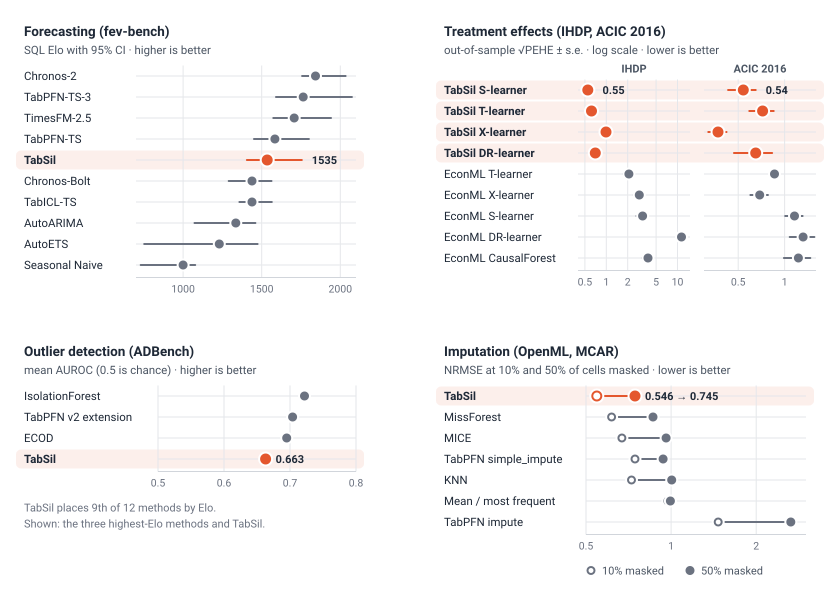

# Task-suite results

Zero-shot results of the v1 weights on forecasting, outlier detection, treatment effects and imputation (`TabSilForecaster`, `TabSilUnsupervised`, `TabSilCATE`; tabsil ≥ 0.1.2), with the protocol, the comparison methods, the caveats and how to reproduce each. The summary is in the [README](../README.md#other-tasks), next to the TabArena-Lite result. The suites, their job specs and environments are in [`training/README.md`](../training/README.md#evaluation).

  <picture>
    <source media="(prefers-color-scheme: dark)" srcset="../assets/charts/other-tasks-dark.svg">
    
  </picture>

## Forecasting (fev-bench)

Zero-shot forecasting with the v1 weights (`TabSilForecaster`, no retraining) on 10 univariate [fev-bench](https://github.com/autogluon/fev) tasks, every rolling window (129), scored with fev's SQL (scaled quantile loss, the main metric) and MASE. The tasks, windows and comparison results are those of [fm-agent-bench](https://github.com/Aiden-Jeon/fm-agent-bench) P7 (commit `b1b0101`), which ran the other methods with the same protocol. Elo is computed over the task means with Seasonal Naive at 1000, with a 95% CI from 200 bootstrap rounds over the tasks.

| Method | SQL Elo | MASE Elo |
| --- | --- | --- |
| Chronos-2 | 1842 (+192/−85) | 1689 (+217/−100) |
| TabPFN-TS-3 (public result) | 1764 (+310/−173) | 1652 (+297/−145) |
| TimesFM-2.5 | 1707 (+234/−133) | 1628 (+262/−145) |
| TabPFN-TS (TabPFN v2) | 1584 (+216/−133) | 1490 (+178/−117) |
| **TabSil** | **1535** (+220/−129) | **1460** (+181/−110) |
| Chronos-Bolt | 1438 (+124/−148) | 1332 (+144/−172) |
| TabICL-TS | 1438 (+126/−80) | 1200 (+124/−152) |
| AutoARIMA (public result) | 1335 (+125/−263) | 1178 (+159/−202) |
| AutoETS | 1230 (+244/−478) | 1167 (+244/−284) |
| Seasonal Naive | 1000 (+77/−270) | 1000 (+123/−341) |

- Snapshot 2026-11-26: fev 0.10.0, data `autogluon/fev_datasets` at `d3e7e72`, 1×H100 (32 min for TabSil), at the Hub tag `v1.1`, i.e. tabsil 0.1.1's inference settings, which `TabSilForecaster()` loads without a model. `TabSilForecaster` ships in tabsil 0.1.2. Our Seasonal Naive reproduces fm-agent-bench's on every window. No window is imputed. Reproduce with `training/scripts/eval.py --suite fev --regressor-path hf://aiden-jeon/tabsil@v1.1` (job spec `training/scripts/eval_fev.yaml` with `TABSIL_REGRESSOR` set to that tag).
- At the tag `v1` (tabsil 0.1.0's settings) TabSil had SQL Elo 1526 (+202/−132) and MASE Elo 1460 (+192/−130), the same place. The settings do not change the task means overall (geometric mean of the ratio `v1.1` / `v1` over the tasks: 1.001 for SQL, 0.999 for MASE). Three tasks move by more than two standard errors over their windows: ecdc_ili is better (SQL −2.1%, on 10 of 10 windows), us_consumption_1M worse (SQL +4.4%, on 9 of 10) and rohlik_orders_1D better in MASE (−2.3%, on 5 of 5). The SQL Elo is higher only because TabSil now passes TabPFN-TS (TabPFN v2) on hospital, a near tie (SQL 0.6939 against 0.6959; 0.6963 at `v1`). The per-task comparison is in [#30](https://github.com/Aiden-Jeon/tabsil/pull/30).
- The tasks are redset_1H, solar_with_weather_1H, ercot_1D, epf_be, rohlik_orders_1D, solar_1D, ecdc_ili, hospital, us_consumption_1M and hospital_admissions_1D. Only known covariates are used, and only by TabSil and TabPFN-TS. The pool differs from the fev-bench leaderboard's, so the numbers are not comparable to it.

## Outlier detection (ADBench)

Unsupervised outlier detection on 12 [ADBench](https://github.com/Minqi824/ADBench) tables × 3 seeds, zero-shot with the v1 weights (`TabSilUnsupervised`, 10 column orders). Each model is fitted on the unlabeled training split, which keeps its anomalies (a contaminated context), and scores the test split. The split, the tables and the comparison numbers come from the fm-agent-bench anomaly track: the official TabPFN extension (`TabPFNUnsupervisedModel.outliers`, TabPFN v2 weights) and pyod's default methods. Our IsolationForest equals ADBench Table D4 on 12/12 tables.

| Method | Mean AUROC | Mean AUPRC | Elo (IsolationForest = 1000) |
| --- | --- | --- | --- |
| IsolationForest | 0.722 | 0.358 | 1000 (+89/−82) |
| TabPFN v2 extension | 0.704 | 0.308 | 992 (+197/−154) |
| ECOD | 0.695 | 0.358 | 971 (+192/−128) |
| **TabSil** | **0.663** | **0.265** | **893** (+149/−156) |

- Elo pool: TabSil, the TabPFN extension and pyod's 10 default methods; TabSil places 9th of 12. TabSil is above the TabPFN extension on 2 of 12 tables (on Waveform by 0.002), above IsolationForest on 5.
- With a clean context (only the training rows labeled normal, a diagnostic that uses labels and stays out of the Elo) TabSil's mean AUROC is 0.820 (TabPFN extension 0.847, IsolationForest 0.767), and it is within 0.01 of the best pyod method or above it on 8 of 12 tables. Like the TabPFN extension, the density model is much stronger than the unsupervised score suggests; the anomalies in the context hurt it most (cover +0.45, cardio +0.31).
- Measured at the Hub tag `v1.1`, i.e. tabsil 0.1.1's inference settings, which `TabSilUnsupervised()` loads without a model. At the tag `v1` (tabsil 0.1.0's settings) TabSil had mean AUROC 0.662, AUPRC 0.264 and Elo 896 (+149/−143), above the TabPFN extension on 1 table: the settings do not change the result, and no table moves by more than its standard deviation over the three seeds. `TabSilUnsupervised` ships in tabsil 0.1.2. Run with `training/scripts/eval.py --suite adbench --regressor-path hf://aiden-jeon/tabsil@v1.1` (8×H100, 13 min). Per-table numbers at `v1`, the differences from the official extension and what is not verified are in [#19](https://github.com/Aiden-Jeon/tabsil/pull/19); the comparison of the two tags is in [#30](https://github.com/Aiden-Jeon/tabsil/pull/30).

## Treatment effects (IHDP, ACIC 2016)

CATE estimation zero-shot with the v1 weights at the Hub tag `v1.1`, i.e. tabsil 0.1.1's inference settings, which `TabSilCATE()` loads without a model. TabSil is the base learner of S/T/X/DR meta-learners, on IHDP (100 realizations: the files of Shalit et al. 2017, 672 training and 75 test rows each) and ACIC 2016 (the 10 simulations shipped with causallib, 4,802 rows × 58 covariates, CausalPFN's 90/10 split). √PEHE is against the noiseless effect mu1 − mu0, within-sample (training rows) and out-of-sample (test rows); ε_ATE is the absolute ATE error. Mean ± standard error over realizations, lower is better. The EconML baselines (0.17.1, default settings, scikit-learn gradient boosting as every base model) ran on the same splits.

| Method | IHDP √PEHE in | IHDP √PEHE out | IHDP ε_ATE out | ACIC √PEHE in | ACIC √PEHE out | ACIC ε_ATE out |
| --- | --- | --- | --- | --- | --- | --- |
| **TabSil S-learner** (default) | **0.52 ± 0.07** | **0.55 ± 0.09** | **0.12 ± 0.01** | 1.09 ± 0.38 | 0.54 ± 0.11 | 0.05 ± 0.02 |
| TabSil T-learner | 0.60 ± 0.05 | 0.62 ± 0.09 | 0.13 ± 0.01 | 1.05 ± 0.23 | 0.72 ± 0.13 | 0.05 ± 0.01 |
| TabSil X-learner | 0.90 ± 0.09 | 0.99 ± 0.16 | 0.18 ± 0.02 | **0.85 ± 0.28** | **0.37 ± 0.05** | **0.05 ± 0.01** |
| TabSil DR-learner | 0.71 ± 0.05 | 0.70 ± 0.06 | 0.19 ± 0.02 | 1.20 ± 0.29 | 0.65 ± 0.18 | 0.06 ± 0.02 |
| EconML T-learner (GBM) | 1.43 ± 0.17 | 2.08 ± 0.33 | 0.25 ± 0.04 | 1.22 ± 0.19 | 0.86 ± 0.03 | 0.13 ± 0.03 |
| EconML X-learner (GBM) | 2.58 ± 0.36 | 2.91 ± 0.48 | 0.32 ± 0.04 | 1.04 ± 0.24 | 0.69 ± 0.09 | 0.08 ± 0.02 |
| EconML S-learner (GBM) | 2.99 ± 0.48 | 3.24 ± 0.58 | 0.49 ± 0.11 | 1.54 ± 0.30 | 1.16 ± 0.15 | 0.21 ± 0.05 |
| EconML DR-learner (GBM) | 19.49 ± 2.75 | 11.38 ± 1.20 | 1.84 ± 0.26 | 2.06 ± 0.44 | 1.32 ± 0.24 | 0.16 ± 0.04 |
| EconML CausalForestDML | 3.60 ± 0.53 | 3.85 ± 0.61 | 0.60 ± 0.07 | 1.65 ± 0.37 | 1.23 ± 0.24 | 0.15 ± 0.04 |

- On IHDP, every TabSil learner has a lower mean √PEHE, within- and out-of-sample, than every EconML baseline (the ATE errors are closer: EconML's T-learner has the lowest within-sample ε_ATE after TabSil's S and T). The means are pulled up by a few realizations with large effects (realization 9: 7.4 for TabSil S vs 17.6 for EconML T). On ACIC 2016 the X-learner is best out-of-sample, TabSil's T-learner is behind EconML's X-learner, and within-sample only TabSil's X-learner is ahead of EconML's X-learner. The default is the S-learner: the best average rank of the four and one fit.
- Against the tag `v1` (tabsil 0.1.0's settings: `standard` members, temperature 0.9; the table in [#22](https://github.com/Aiden-Jeon/tabsil/pull/22)), the DR-learner is better on IHDP (√PEHE 0.82 → 0.71 within-sample and 0.75 → 0.70 out-of-sample, ε_ATE 0.24 → 0.19) and the S-learner slightly worse (0.50 → 0.52 and 0.53 → 0.55); both are beyond the standard error of the paired difference over the 100 realizations. Every other cell of the table moves by 0.04 or less, within the standard errors shown, and the order of the learners does not change. At `v1` the S-learner's out-of-sample √PEHE was below the best EconML method's on 100 of 100 realizations; that count was not redone at `v1.1`, because the EconML results per realization were not kept. The comparison per learner is in [#30](https://github.com/Aiden-Jeon/tabsil/pull/30).
- Published numbers on the same files, with protocol differences (`training/src/tabsil_train/benchmarks/causal/causal_reference.csv`): CausalPFN (Balazadeh et al. 2025) reports out-of-sample √PEHE 0.58 ± 0.07 on IHDP and 0.92 ± 0.11 on ACIC 2016, TabPFN as the outcome model 0.95 ± 0.20 and 0.54 ± 0.08, with baselines tuned per dataset (their Table 1, IHDP T-learner 1.73, BART 2.50). Shalit et al. 2017 report CFR-Wass 0.71 / 0.76 (in / out) on IHDP, averaged over 1,000 realizations instead of these 100.
- `TabSilCATE` ships in tabsil 0.1.2.
- Snapshot 2026-11-26: TabSil on 1×H100 (17 min job, 440 fits of a learner on a realization, 0 failed, nothing imputed); EconML on a laptop CPU. Reproduce with `training/scripts/eval.py --suite causal --regressor-path hf://aiden-jeon/tabsil@v1.1` (job spec `training/scripts/eval_causal.yaml` with `TABSIL_REGRESSOR` set to that tag; the EconML methods need the `causal` extra).

## Imputation (OpenML, MCAR)

Zero-shot missing value imputation with the v1 weights (`TabSilUnsupervised.impute`: the predictive mean for numeric cells, the most probable class for categorical cells) on 10 OpenML tables: 3 numeric only and 7 with categorical columns, at most 2,000 rows and 21 columns. Cells are masked completely at random (MCAR) at 10, 30 and 50%, with 3 seeds each. Every method fills the same masked table (it is fitted on the rows it imputes) and is scored on the masked cells. NRMSE is the RMSE divided by the column's standard deviation (mean imputation is about 1; lower is better), averaged over numeric columns. Accuracy is averaged over categorical columns. Both are then averaged over tables. No published results exist for this protocol, so every method was run here on the same rows and masks.

| Method | NRMSE 10% | NRMSE 30% | NRMSE 50% | Accuracy 10% | Accuracy 30% | Accuracy 50% |
| --- | --- | --- | --- | --- | --- | --- |
| **TabSil** | **0.546** | **0.646** | **0.745** | **0.652** | **0.632** | **0.590** |
| MissForest | 0.616 | 0.744 | 0.863 | 0.632 | 0.602 | 0.556 |
| MICE | 0.670 | 0.807 | 0.960 | 0.617 | 0.589 | 0.552 |
| TabPFN v2 extension, `simple_impute` | 0.745 | 0.855 | 0.937 | 0.624 | 0.602 | 0.565 |
| KNN | 0.724 | 0.912 | 1.005 | 0.576 | 0.519 | 0.483 |
| Mean / most frequent | 0.974 | 0.995 | 0.994 | 0.496 | 0.487 | 0.489 |
| TabPFN v2 extension, `impute` | 1.467 | 2.167 | 2.651 | 0.564 | 0.533 | 0.490 |

- TabSil has a lower NRMSE than every baseline on 25 of the 30 (table, rate) cells. The other 5 are bank-marketing at all three rates and adult at 10% and 50%, where TabPFN's `simple_impute` is lower (at adult 10% MICE too, at bank-marketing 10% MICE and MissForest too). TabSil's accuracy is higher than every baseline's on 19 of 21 cells. At cmc 10% it is a tie in effect (0.666 against `simple_impute`'s 0.667), and at yeast 10% MissForest is higher (0.595 against 0.577).
- The median instead of the mean gives NRMSE 0.560 / 0.669 / 0.767, slightly worse, as expected for RMSE. TabSil with the TabPFN extension's column kinds (below) gives 0.583 / 0.693 / 0.802.
- Both TabPFN extension methods also treat numeric columns with few distinct values (at most 40, more than 10 rows per value) as categorical and cast their values to `int`. This gives large errors on such columns: yeast `erl`, with values 0.5 and 1, has NRMSE 10.4 under both methods. `impute` also has large errors on numeric-only tables (california_housing `totalBedrooms` 5.6), so the column kinds do not explain all of it; the cause was not investigated. To run at all, `impute` needed tabpfn-extensions at commit a049fd7, because the 0.6.3 release fails on CUDA, and a fix of its class count for categorical columns with missing values.
- Time per (table, rate, seed) on H100: TabSil 3.4 s (8 members), `simple_impute` 6.7 s, `impute` 328 s. MissForest takes 11.6 s on the CPU.
- TabSil is measured at the Hub tag `v1.1`, i.e. tabsil 0.1.1's inference settings, which `TabSilUnsupervised()` loads without a model. At the tag `v1` (tabsil 0.1.0's settings) it had NRMSE 0.547 / 0.647 / 0.746 and accuracy 0.653 / 0.632 / 0.590, ahead at cmc 10% by 0.001 (20 of 21 cells): the differences are smaller than the spread over the three seeds ([#30](https://github.com/Aiden-Jeon/tabsil/pull/30)). `TabSilUnsupervised.impute` ships in tabsil 0.1.2.
- Run with `training/scripts/eval.py --suite impute` (job spec `training/scripts/eval_impute.yaml`, 8×H100 `--shards 8`, 68 min). MICE comes from a second run (14 min) after a fix of its categorical encoding, and TabSil at `v1.1` from a third (`--regressor-path hf://aiden-jeon/tabsil@v1.1 --impute-methods tabsil,tabsil_inferred`, 1×H100, 12 min); the baselines were not run again. The per-table numbers, the differences from the official `impute` and what is not verified are in [#24](https://github.com/Aiden-Jeon/tabsil/pull/24).
